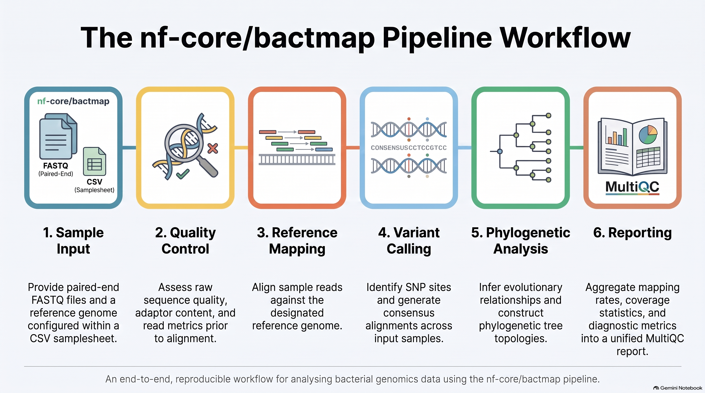
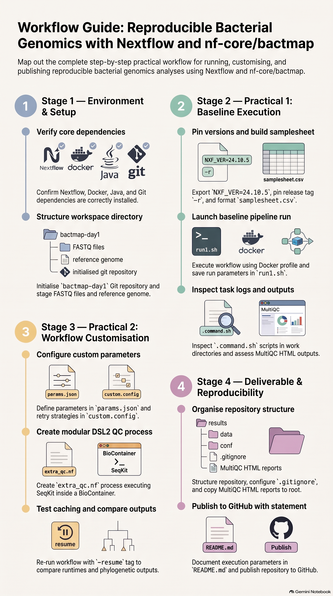

# Day 1 Practical Handbook: Reproducible Bacterial Genomics with Nextflow and nf-core/bactmap

**Thursday 29 October 2026 · Afternoon practicals**

By the end of this session you will have run an nf-core workflow, changed it, re-run it, compared the results, and published everything in a GitHub repository.

> **Nextflow version:** bactmap 1.0.0 needs an older Nextflow than the latest release (see Section 1.4). On the course VMs `NXF_VER` is already set to 24.10.5.

> **Trainer check before the day:** pipeline options and versions change between releases. Confirm the parameter names below against `nextflow run nf-core/bactmap -r <version> --help` and <https://nf-co.re/bactmap/parameters>, and confirm the container tag used in Practical 2.

------------------------------------------------------------------------





## 0. Setup (10 min)

Check your tools:

``` bash
nextflow -version
docker --version        # or: apptainer --version
java -version
git --version
```

Create your working directory and Git repository:

``` bash
mkdir bactmap-day1 && cd bactmap-day1
git init
mkdir -p data results docs
```

Course data (trainers supply this): a folder of paired-end bacterial FASTQ files and one reference genome (`reference.fasta`). Copy them into `data/`.

------------------------------------------------------------------------

## Practical 1: Running an nf-core workflow

### 1.1 Explore the workflow and its parameters (15 min)

``` bash
nextflow run nf-core/bactmap -r <VERSION> --help
nextflow pull nf-core/bactmap -r <VERSION>
nextflow info nf-core/bactmap
```

Open <https://nf-co.re/bactmap> and answer in your notes:

1.  What does bactmap do, in one sentence?
2.  Which tools does it run (QC, mapping, variant calling, phylogeny)?
3.  Which parameters are **required**?
4.  Which version (release tag) will you pin, and why?

### 1.2 Check your Nextflow and Docker setup (5 min)

``` bash
nextflow run hello -with-docker
docker run hello-world
```

Both should finish without errors. If they fail, jump to the troubleshooting table at the end.

> **Note:** the built-in `-profile test` for bactmap 1.0.0 currently fails, because the test data it downloads is no longer available online. This is a real-world reproducibility lesson: workflows that depend on remote data can break over time. In this course we use the supplied course data instead.

### 1.3 Create a samplesheet (15 min)

bactmap expects a CSV with these columns:

| sample | fastq_1                       | fastq_2                       |
|--------|-------------------------------|-------------------------------|
| ISO001 | /full/path/ISO001_R1.fastq.gz | /full/path/ISO001_R2.fastq.gz |

Generate it from your data folder:

``` bash
shopt -s nullglob   # if nothing matches, the loop does not run (instead of writing a literal '*' path)
echo "sample,fastq_1,fastq_2" > samplesheet.csv
for r1 in $PWD/data/*_R1*.fastq.gz; do
  r2=${r1/_R1/_R2}
  s=$(basename "$r1" | sed 's/_R1.*//')
  echo "$s,$r1,$r2" >> samplesheet.csv
done
[ "$(wc -l < samplesheet.csv)" -gt 1 ] || echo "No samples found: check the file names in data/"
cat samplesheet.csv
```

Check: one row per sample, no spaces in sample names, every path exists (`cut -d, -f2,3 samplesheet.csv | tr ',' '\n' | tail -n +3 | xargs ls`).

### 1.4 Launch the workflow (20 min)

``` bash
nextflow run nf-core/bactmap \
  -r <VERSION> \
  -profile docker \
  --input samplesheet.csv \
  --reference data/reference.fasta \
  --outdir results/run1 \
  -with-report results/run1_nextflow_report.html \
  -with-trace results/run1_trace.txt \
  -with-timeline results/run1_timeline.html
```

Save this exact command in a file called `run1.sh`. It is part of your deliverable.

Add this line at the top of `run1.sh` (and `run2.sh`) so the Nextflow version is pinned too. bactmap 1.0.0 is an older pipeline and fails to parse under the newest Nextflow releases:

``` bash
export NXF_VER=24.10.5
```

While it runs, watch the console: each line is a process; brackets show the task hash and `[3/12]` style progress.

### 1.5 Examine logs (15 min)

``` bash
nextflow log                       # history of runs
nextflow log last -f name,status,duration,workdir
cat .nextflow.log | tail -50
```

Find one task's work directory and look inside:

``` bash
ls -la work/ab/cdef12*/
cat work/ab/cdef12*/.command.sh    # exact command executed
cat work/ab/cdef12*/.command.err   # stderr
```

Questions: Which process took longest? Which container image ran the mapping step? (Look in `.command.run` or the pipeline's `conf/modules.config`.)

### 1.6 Generate and read the MultiQC report (15 min)

MultiQC runs automatically. Open `results/run1/multiqc/multiqc_report.html` and check:

-   Read quality and adapter content (FastQC)
-   Mapping rate per sample
-   Mean coverage per sample
-   Any sample you would flag or exclude, and why

Also find the phylogenetic tree and the consensus/SNP alignment in `results/run1/`. Note the file names.

**Commit your progress:**

``` bash
git add samplesheet.csv run1.sh
git commit -m "Practical 1: samplesheet and first run"
```

------------------------------------------------------------------------

## Practical 2: Modifying a workflow

### 2.1 Change workflow parameters (20 min)

Put your settings in a parameters file instead of a long command. Create `params.json`:

``` json
{
  "input": "samplesheet.csv",
  "reference": "data/reference.fasta",
  "outdir": "results/run2"
}
```

Now add **two** changes. Check the parameter names in `--help` first. Typical bactmap options include read trimming and recombination removal (for example `trim`, `remove_recombination`). Record which you chose and why.

Create `custom.config` to set resources and keep your changes in version control:

``` groovy
process {
    withName: '.*' {
        maxRetries    = 1
        errorStrategy = { task.exitStatus in [137,143] ? 'retry' : 'finish' }
    }
}

// let re-runs replace earlier report files instead of failing
trace.overwrite    = true
report.overwrite   = true
timeline.overwrite = true
```

Run:

``` bash
nextflow run nf-core/bactmap -r <VERSION> -profile docker \
  -params-file params.json -c custom.config \
  -with-report results/run2_nextflow_report.html \
  -with-trace results/run2_trace.txt
```

Save as `run2.sh`.

### 2.2 Add an extra QC step (30 min)

You will add a small DSL2 process that reports read statistics with **seqkit** (number of reads, length, Q30). It runs in a BioContainer, so you need to install nothing.

Create `extra_qc.nf`:

``` groovy
nextflow.enable.dsl = 2

params.input  = 'samplesheet.csv'
params.outdir = 'results/extra_qc'

process SEQKIT_STATS {
    tag "$meta.id"
    container 'quay.io/biocontainers/seqkit:2.8.2--h9ee0642_1'   // verify tag on quay.io
    publishDir "${params.outdir}/seqkit", mode: 'copy'

    input:
    tuple val(meta), path(reads)

    output:
    path "${meta.id}.seqkit.tsv"

    script:
    """
    seqkit stats -a -T ${reads} > ${meta.id}.seqkit.tsv
    """
}

workflow {
    Channel
        .fromPath(params.input)
        .splitCsv(header: true)
        .map { row ->
            def reads = [file(row.fastq_1)]
            if (row.fastq_2) reads << file(row.fastq_2)
            tuple([id: row.sample], reads)
        }
        | SEQKIT_STATS
}
```

Run it:

``` bash
nextflow run extra_qc.nf -with-docker --input samplesheet.csv
cat results/extra_qc/seqkit/*.tsv
```

Discuss: this is a **process** (what to run), fed by a **channel** (what data). Where are the inputs, outputs and container declared?

**Stretch goal:** clone the pipeline (`git clone https://github.com/nf-core/bactmap`), copy your process into `modules/local/`, call it from `workflows/bactmap.nf`, and run it with `nextflow run ./bactmap`. Note how this breaks the "official release" link, and what that means for reproducibility and for contributing back via nf-core.

### 2.3 Re-run and compare outputs (20 min)

Re-run with `-resume` after a small change to see caching in action. Unchanged steps should show `cached`.

``` bash
nextflow run nf-core/bactmap -r <VERSION> -profile docker \
  -params-file params.json -c custom.config -resume
```

Compare run 1 and run 2:

``` bash
# Task counts and runtimes
column -t -s$'\t' results/run1_trace.txt | cut -c1-120 | head
# Mapping stats and tree
diff <(find results/run1 -type f | sed 's|run1/||' | sort) \
     <(find results/run2 -type f | sed 's|run2/||' | sort)
```

Fill in this table:

| Question                     | Run 1 | Run 2 |
|------------------------------|-------|-------|
| Samples passing QC           |       |       |
| Total SNP sites in alignment |       |       |
| Tree topology changed?       |       |       |
| Total runtime                |       |       |
| Cached tasks                 |       |       |

Open both MultiQC reports side by side. Which parameter change explains each difference?

------------------------------------------------------------------------

## Deliverable: your GitHub repository

### Required contents

```         
bactmap-day1/
├── README.md                  # includes the reproducibility statement
├── samplesheet.csv
├── run1.sh                    # first Nextflow command
├── run2.sh                    # modified command
├── params.json
├── custom.config
├── extra_qc.nf
├── multiqc_report_run1.html
├── multiqc_report_run2.html
└── docs/comparison.md         # your table and short interpretation
```

Do **not** commit `work/`, large FASTQ files or full result folders. Create a `.gitignore`:

```         
work/
.nextflow*
data/
results/*/
!results/*/multiqc/
```

Copy the MultiQC reports out of `results/` into the repository root first:

``` bash
cp results/run1/multiqc/multiqc_report.html multiqc_report_run1.html
cp results/run2/multiqc/multiqc_report.html multiqc_report_run2.html
```

Publish:

``` bash
git add .
git commit -m "Day 1 deliverable"
git branch -M main
git remote add origin https://github.com/<USERNAME>/bactmap-day1.git
git push -u origin main
```

### Reproducibility statement template

Paste into `README.md` and complete every field (about 150 words).

``` markdown
## Reproducibility statement

**Workflow:** nf-core/bactmap, release <VERSION> (https://github.com/nf-core/bactmap)
**Nextflow version:** <output of nextflow -version>
**Execution profile:** <docker/singularity/apptainer>, container images pulled automatically
by the pipeline; versions recorded in `results/run*/pipeline_info/`.
**Input data:** <source, accession numbers or description>; listed in `samplesheet.csv`.
**Reference genome:** <name, accession, date downloaded>
**Parameters:** all non-default parameters are in `params.json` and `custom.config`.
**Commands:** `run1.sh` (defaults) and `run2.sh` (modified: <list changes>).
**Extra QC:** `extra_qc.nf` runs seqkit <version> in a BioContainer.
**To reproduce:** clone this repository, place data as described, then run `bash run2.sh`.
**Known limitations:** <e.g. data not shared, random seeds, hardware-dependent runtimes>
```

### Self-check before submitting

-   [ ] Someone else could rerun your commands without asking you anything
-   [ ] The pipeline release is pinned with `-r`
-   [ ] No absolute paths specific to your laptop remain, except in the samplesheet (explain this in the README)
-   [ ] Both MultiQC reports open in a browser
-   [ ] The statement names versions, not just tool names

------------------------------------------------------------------------

## Troubleshooting

| Symptom | Likely cause | Fix |
|----|----|----|
| `Cannot connect to the Docker daemon` | Docker not running or no permissions | Start Docker; add user to the `docker` group; or use Apptainer |
| Samplesheet validation error | Wrong header, spaces, missing file | Check column names and paths |
| `Unknown method invocation exists on LinkedList` | A path in the samplesheet contains a wildcard (`*`, `?`, `[ ]`), usually because no files matched | Open `samplesheet.csv`, make sure every path is a real file, and rebuild it |
| `exit status 137` | Out of memory | Raise memory in `custom.config` or `--max_memory` |
| Pipeline restarts everything | Changed inputs or no `-resume` | Use `-resume` from the same directory |
| `Trace file already exists` (or report/timeline) | Nextflow won't overwrite these files from an earlier run | Delete the old files, use new file names, or set `trace.overwrite = true` (see `custom.config`) |
| Unknown parameter warning | Misspelt or renamed in this release | Check `--help` for the pinned version |
| Container pull rate limit | Registry limits | Pre-pull images or use the course cache |

## Glossary

**Channel** – queue of data that connects processes. **Process** – one step that runs a script. **Work directory** – where Nextflow runs each task. **Profile** – bundle of settings (e.g. `docker`). **`-resume`** – reuse cached results. **BioContainer** – community-built container for a bioinformatics tool.
